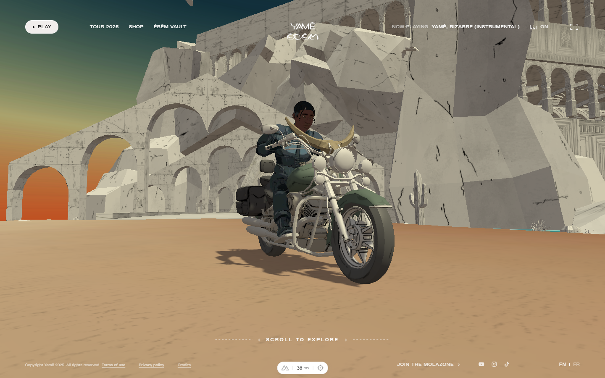

# Molazone 还原（FastBike）

基于第一阶段从 `mola-zone.com` HAR 抓包中提取的真实资源，用 **Nuxt 4 (Vue 3) + Three.js + Theatre.js + Howler + Lottie** 还原 Yamê / ÉBĒM 官方站首页：UI + 全屏 3D 沙漠场景。

> 当前进度：**阶段 4 — Three.js 3D 场景还原**（阶段 1 资源提取见 `RESOURCE_MANIFEST.md`，阶段 2 初始化、阶段 3 UI 见下方）



## 本地运行

```bash
npm install          # 首次安装依赖
npm run assets:sync  # 同步第一阶段资源到 public/（幂等，可随时重跑）
npm run dev          # 启动开发服务器
```

访问 <http://localhost:3000> （默认 3000 端口，被占用时 Nuxt 会自动换端口并打印实际地址）

| 命令 | 用途 |
| --- | --- |
| `npm run build` | 生产构建（`.output/`） |
| `npm run preview` | 预览生产构建 |
| `npm run generate` | 静态站点生成（SSG） |
| `npm run assets:sync` | 把 `extracted/` 镜像到 `public/assets/` 与 `public/fonts/` |

## 还原内容与实现

设计数据不是估算的：颜色、字号、间距、尺寸全部取自**第一阶段抓到的原站 CSS**（`extracted/css/_nuxt/entry.B2OHENv6.css`，205 条相关规则）与**线上原站的计算样式**。

| # | 需求 | 实现 | 关键取值 |
| --- | --- | --- | --- |
| 1 | 全屏黑色背景 | `.app` / `.webglRenderTargetContainer` | `--c-secondary` = `#0b0b0c` |
| 2 | 顶部导航栏 | `MolaHeader.vue` | 距顶 52px，左右内边距 60px，z-index 3 |
| 3 | Logo 位置与尺寸 | `MolaLogo.client.vue`（Lottie） | 绝对居中 `left:50%`、`translateY(-3px)`，高 50px |
| 4 | Play 按钮 | `MolaHeader.vue` | 胶囊 32px 高 / `padding 0 16px` / 圆角 50px / 沙白底 `rgb(240,237,235)` / 悬停切换摩托图标 |
| 5 | TOUR 2025 / Shop / ÉBĒM Vault | `MolaHeader.vue` | 10px / 700 / 字距 .63px / 导航左移 142px |
| 6 | Now Playing 音频区域 | `MolaHeader.vue` + `useMolaAudio.ts` | 标签 60% 白、曲名 10px/700、波形条动画、ON/OFF 切换，真实播放 `BIZARRE.mp3` |
| 7 | Fullscreen 控制 | `MolaHeader.vue` | 19×14 图标，原生 Fullscreen API |
| 8 | 页面底部信息 | `MolaFooter.vue` | 固定底部 24px 60px、9px 字号、社媒 14px 图标、EN/FR 切换 |
| 9 | 字体 / 颜色 / 间距 / 对齐 | `app/assets/css/main.css` | Kern 字体、13px/500 基准、`--c-primary` 白、米白分隔线 |
| 10 | Loading 页面 | `MolaLoader.vue` | 四宫格插画 + 28.125vw 中心圆 + 旋转图形 + 百分比 + ENTER |

### 交互流程（与原站一致）

1. 进入页面 → Loading：四张线稿背景、中心圆符号、百分比从 0 递增到 100%
2. 百分比与**三个 GLB 的真实字节级加载进度**联动（未加载完时封顶 92%）
3. 100% 后中心出现 **ENTER** 胶囊按钮（悬停反色）
4. 点击 ENTER → 白色圆形扩散过渡 → 主界面淡入，同时开始播放 Now Playing（点击手势内触发，规避自动播放限制）
5. 左上 **PLAY** 可重播 Loading 过场

## 3D 场景（阶段 4）

`app/utils/mola3d/sceneManager.ts` 是唯一负责 Three.js 的模块，`MolaScene3D.client.vue` 负责生命周期与错误 UI。所有参数都逆向自原站 `gpNsPhdA.js` 与 `state_v9.json`，不是估的。

| 项 | 取值 / 做法 | 来源 |
| --- | --- | --- |
| 渲染器 | `antialias:false, stencil:false, alpha:false, depth:true, powerPreference:'high-performance'`，`outputColorSpace=srgb`，`pixelRatio=min(2,dpr)`，`shadowMap=PCF` | 原站 `RENDERER_CONFIG` |
| 背景色 | `#030303` | 原站 `SCENE_BACKGROUND_COLOR = 197379` |
| 相机 | fov **55**、跟随偏移 **(-1.5, 0.5, 3)**、看向偏移 **(0, 0.7, 0)** | 原站 `cameraViews.HomeDesktop` + `cameraConstraintPosition` |
| 相机跟随 | 在 bike group 下挂两个 `Object3D` 约束节点，每帧取其世界坐标 | 原站 `initConstraints()` |
| 太阳 | 方向 **(-0.4, 1, -0.5)**、色 `rgb(0.867,0.804,0.545)`、投影跟随 bike | 原站 `lightsConfig` + `state_v9.World.sun` |
| 光强 | 太阳 2.6 / 半球 0.5 / 环境 0.28 | 原站 3.0 是给自定义 Toon shader 的，原始 PBR 需按物理重新标定 |
| 摩托位置 | 半径 **120** 圆轨道，phi = **5.92023817104828** → `(112.2, 0, -42.6)`，朝向切线 | 原站 `worldConfig.RADIUS` / `bikeConfig.INITIAL_PHI` / `moveBike()` |
| 摩托配色 | 墨绿挡泥板 `#2e4035`、米白车身 `#cbc8c1`、深灰座椅 `#1f1f21`、黄铜喇叭 `#7e6842`、深灰轮胎 `#2b2c2d` | `state_v9.json → sheetsById.bike.staticOverrides.byObject` |
| 地面 | 换用 `map_ground_v2.1.webp`（原站预烘焙沙色）作 baseColor + R/G/B 细节层调制 | 原站 `MeshBlendRampNoiseToonMaterial` |
| 天空 | `skybox-day.jpg`（50×1600 垂直渐变条）→ 内翻球体 + 竖向渐变着色 | 原站 `createRenderTargetShader` |
| 鸟群 | `oiseau_v1.glb` 克隆 9 只绕摩托上空分布 | 原站把该 geometry 做成 GPU 粒子群 |
| 隐藏 | `obstacle_0~3`（game 模式关卡障碍物，会挡视线） | `state_v9` 的 `Zone Visibility - Game` |

### 加载管线

- `GLTFLoader` + `DRACOLoader`（本地 `draco_wasm_wrapper.js` / `draco_decoder.wasm`，1.5.7）+ `KTX2Loader`（本地 `basis_transcoder.js/.wasm`，`detectSupport(renderer)`）
- 三个 GLB 用 `fetch` + `arrayBuffer` 读取以获得字节级进度，再走 `GLTFLoader.parse`
- 进度按文件体积加权：scene 6.32 / bike 3.02 / oiseau 0.08

### 错误处理

| 情况 | 处理 |
| --- | --- |
| 无 WebGL | 显示 `3D scene unavailable` 提示，页面其余 UI 正常 |
| GLB 加载/解码失败 | 记录具体文件名到提示条与控制台；oiseau 失败不阻塞主场景 |
| 单帧渲染异常 | 渲染循环内 try/catch，仅首次记录，不冒泡到 Vue（避免整页白屏） |
| WebGL 上下文丢失 | 监听 `webglcontextlost` 暂停循环 + `webglcontextrestored` 重建尺寸并恢复 |
| 着色器预编译失败 | 降级跳过，不影响后续渲染 |

### 修过的两个模型兼容问题

1. **InstancedMesh 缺 morphTargetInfluences**：`tree_chain_02_instance_forest` / `tree_chain_instance_forest` 带 morph targets 但 `EXT_mesh_gpu_instancing` 生成时未初始化数组，three r187 渲染时读 `.length` 崩溃。运行时补齐全 0 数组（不改几何）。
2. **KTX2 贴图只是遮罩**：bike/场景原始 `baseColorTexture` 不能直接呈现原站外观，按原站做法换用 `map_ground_v2.1` 与 state_v9 配色。

### 调试入口

控制台可用 `window.__mola3d`（`MolaSceneManager` 实例）：

```js
__mola3d.getDebugInfo()                      // 包围盒 / 材质 / 灯光 / 相机 / draw call
__mola3d.getGroundHeightAt(x, z)             // 采样地面高度
__mola3d.applyCodeDefaultHomeView()          // 切到原站代码默认机位对比
```

### 资源使用（全部来自第一阶段提取）

| 用途 | 文件 |
| --- | --- |
| Logo | `logo_anim_v3.json`（Lottie 5.7.0，800×400，60fps） |
| Loading 背景 | `loader_background01~04.webp` |
| Loading 五向形状 | `loader_left/top/bottom/right/centerShape.webp` |
| 字体 | `Kern-Regular / Medium / Bold.woff2` |
| 音频 | `radio/BIZARRE.mp3`（Now Playing） |
| 页脚社媒 | `youtube.svg` / `instagram.svg` / `tiktok.svg` |
| 内联图标 | 原站 DOM 中的 `uiIconPlay` / `uiIconMoto` / fullscreen / loader 中心符号（已提取为 `public/ui/`） |

## 目录结构

```
fastbike/
├── app/
│   ├── app.vue                  # 入口：NuxtLayout + NuxtPage
│   ├── layouts/default.vue      # 全屏黑色舞台 .app.dark
│   ├── components/
│   │   ├── MolaHeader.vue       # 顶部导航（Play / 导航 / Logo / Now Playing / Fullscreen）
│   │   ├── MolaFooter.vue       # 底部信息（版权 / 法务链接 / 社媒 / 语言）
│   │   ├── MolaLoader.vue       # Loading 页（四宫格 + 中心圆 + 进度 + ENTER）
│   │   ├── MolaScene3D.client.vue # 全屏 Three.js 场景（挂载/进度/错误 UI）
│   │   └── MolaLogo.client.vue  # Lottie Logo（仅客户端渲染）
│   ├── composables/
│   │   ├── useMolaAudio.ts      # Now Playing 音频（Howler，含原生 Audio 回退）
│   │   └── useAssets.ts         # 静态资源路径工具
│   ├── utils/mola3d/
│   │   └── sceneManager.ts      # Three.js 场景管理器（渲染器/相机跟随/灯光/加载/配色/天空/错误恢复）
│   ├── pages/index.vue          # 首页：3D 舞台 + 页头 + 滚动提示 + 页脚 + Loader
│   └── assets/css/main.css      # 全局主题、原站排版类、组件样式基座
├── public/
│   ├── assets/                  # 第一阶段 93 个资源镜像（原始层级）
│   ├── fonts/                   # Kern ×3（@font-face 引用）
│   └── ui/                      # 图标：moto.svg、loader-shape.svg
├── scripts/sync-assets.mjs      # extracted/ → public/ 同步（幂等，带核对）
├── analysis/                    # 分析产物与截图（screenshots/ 含原站与本地对照）
├── extracted/                   # 第一阶段只读源
├── RESOURCE_MANIFEST.md         # 资源清单
└── nuxt.config.ts
```

## 已知事项

- **3D 场景为静态展示**：本阶段按要求只保证场景正确渲染，未接入动画。bike 自带的 12 个动画（Idle/Left/Right/Stop/wind…）、滚动驱动的相位移动、Theatre.js 的 `Orbital Sequence` 都留到下一阶段。
- **原站是赛璐璐（Toon）渲染**：原站把 GLB 材质整体替换为 `generateMeshRampNoiseToonMaterial`，本实现保留 GLB 原始 PBR 材质 + state_v9 配色，因此明暗过渡比原站更写实、少一层描边。若要与原站完全一致，需要移植那套 Toon/描边 shader。
- **headless 环境 WebGL 限制**：无 GPU 的 headless Chrome（SwiftShader）渲染该场景会触发 `WebGL context lost`，属软件渲染资源限制；真实 GPU 浏览器（`--headed`）实测 187 draw call / 163 万三角形稳定无错。
- **Logo 存在编码瑕疵**：`logo_anim_v3.json` 的图层名是 UTF-8 双重编码（`Logo Yamê`），不影响播放。
- **页脚法务链接**为占位（原站指向 PDF）。
- 开发环境曾出现 `[safe-delete][SAFE_DELETE_BULK_CONFIRM_REQUIRED]`：沙箱禁止单次删除 >50 个文件，Vite 重优化依赖时删缓存触发。处理方式：清空 `node_modules/.cache/vite` 后重启；已把 `howler` / `lottie-web` 加入 `vite.optimizeDeps.include` 避免反复重优化。
- **Nuxt 4 `.client` 组件挂载时序**：`.client.vue` 的 `onMounted` 触发时 template ref 可能还是 `null`（Suspense 下 DOM 后插入）。场景组件改用 `watch(ref, ..., { flush: 'post' })` 初始化。
- 资源来自第三方站点抓包，仅用于本地学习与还原验证。
