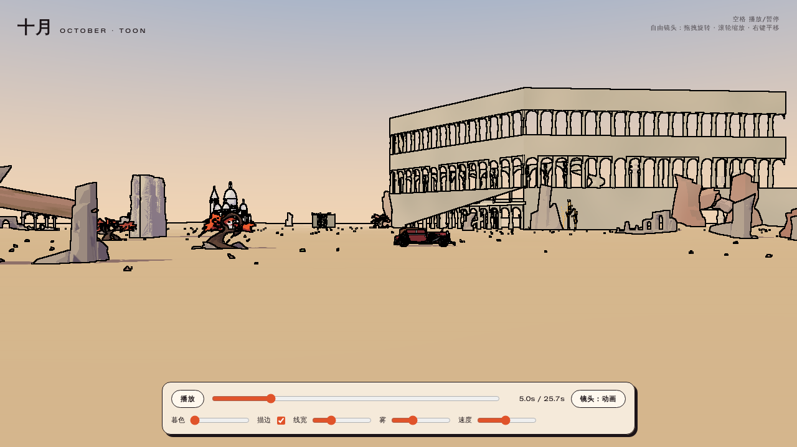
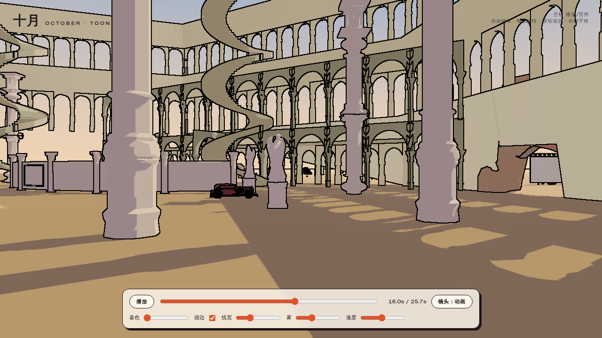

# 十月 · Toon Web

用 `motorbike/` 里逆向出的 Toon（赛璐璐）shader 渲染 `model/十月-test.glb`（C4D 导出、白模、25.7 s 镜头 + 老爷车动画）。



| 老爷车特写（自由镜头） | 暮色 | 宫殿内景 |
| --- | --- | --- |
|  |  |  |

## 运行

```bash
cd october-toon
npm install
npm run dev        # http://localhost:5173
npm run build      # 产物在 dist/（相对路径，可直接丢到任意静态服务器）
npm run preview    # 预览生产构建
```

操作：空格 播放/暂停；底部面板有时间轴、`镜头：动画/自由` 切换（自由镜头 = OrbitControls）、暮色、描边开关、线宽、雾、速度。
调试入口：控制台 `__october`（`setTime(t)`、`setDusk(v)`、`setFog(v)`、`freeCam(pos, target)`、`animCam()`、`info()`）。

## motorbike 的 shader 实现（移植了什么）

| 模块 | motorbike 来源 | 做法 |
| --- | --- | --- |
| Toon 材质 | `toonMaterial.ts` → 原站 `MeshRampNoiseToonMaterial` | `MeshToonMaterial` + `onBeforeCompile` 替换 `<lights_toon_pars_fragment>`：直射光只取 3 阶梯度贴图（46/158/255，Nearest）的灰度，间接光清零；`<opaque_fragment>` 里用灰度在 `uDirectColor`/`uIndirectColor` 两色间混合 → 纯平色块 + 硬阴影。太阳光强 3（× 1/π ≈ 0.955 → 受光面 ≈ directColor） |
| Toon 阴影（十月改动） | — | 原站把 PCF 阴影（0~1 连续值）直接乘进梯度，阴影是一团软边灰阶。这里把阴影二值化（`fwidth` 抗锯齿的 1px 硬边），在阴影里的像素直接落到梯度最暗一阶 → 阴影与背光面同色、纯平；并设 `shadowSide = DoubleSide`，避免单层面片（车身、建筑）漏光 |
| 雾 | 原站 `FogBundle` | 强制 `USE_FOG + FOG_EXP2`，3D Perlin 噪声扰动雾深度、`fogTime` 缓慢流动，近/远两色 |
| 描边 | `outlinePass.ts` → 原站 `MoebiusEffect` | ① override 材质把每个 mesh 画成唯一灰度 identity（+ 深度项）② 正常颜色 pass ③ 对 identity 图做 3×3 Sobel，`× intensity(100)` 后混成黑线 |
| 日夜 | `setToonPaletteMix` | 每个色板 day / night 两套，按 mix 插值 —— 这里用作「暮色」滑杆 |
| 渲染器 | `RENDERER_CONFIG` | `antialias:false`、`pixelRatio ≤ 2`、PCF 阴影、`shadowMap.autoUpdate=false` 每帧手动更新 |

## 十月这边做的事

1. **模型压缩**（`scripts/optimize-model.mjs`，gltf-transform + meshoptimizer）：305 MB / 669 万三角 → **26.7 MB / 254 万三角**。dedup（1015 → 661 个网格，重复的石头/仙人掌合并）、weld、meshopt simplify（ratio 0.35、误差 0.15%）、去掉用不到的 UV、量化 + `EXT_meshopt_compression`。节点名、层级、动画全部保留。
   重新生成：`npm run model -- ../model/十月-test.glb public/models/october.glb`（先按 `model/README.md` 合并解压）。
2. **配色**（`src/palettes.ts`）：源模型 1013 个材质全是白色，颜色只能按节点路径分配。
   - 与 motorbike 场景同源的资源（`arch0xx`、`big_arch`、`palace*`、`stair_*`、`terasse`、`rock_dune_*_root`、`batiment`）直接用 motorbike 的 `toon-colors.json` 原值；
   - 十月独有的（凯旋门、圣心教堂、巴黎圣母院、枫树/枫叶、老爷车……）按秋日主题配色；老爷车按 C4D 子材质名（漆面 / 镍银 / 枪灰 / 胎面 / 皮革 / 尾灯）上色。
3. **地面延伸**：模型地面是一块不规则圆盘，镜头会拍到外面的虚空。运行时提取地面网格外边界环，向外做两圈过渡环（河道在边界的下切收回地平面），再 earcut 铺满 ±2500，远处交给雾融进天际线。
4. **相机**：C4D 导出的 `yfov=0.14 / aspectRatio=10.28` 实际是「水平 FOV 71.5°」，按窗口比例换算竖直 FOV（宽屏锁 16:9 构图，竖屏锁水平 FOV，上限 80°）。

## 修掉的 motorbike 描边 bug（已在本项目修复，motorbike 本身未改）

- **所有物体共用一个 identity**：identity pass 里整场只有一个 override `ShaderMaterial`，three 对连续同材质绘制不会重新上传 uniform，`onBeforeRender` 写的 `uIdentity` 根本没生效 → 只有物体与天空交界处有线。修复：写完后置 `uniformsNeedUpdate = true`。
- **地面上的假横线**：identity 叠加了 `gl_FragCoord.z * 0.05`，8-bit RT 每跨一个 1/255 台阶，Sobel ×100 就画出一条横贯画面的黑线。identity RT 改为 HalfFloat。
- **地面 / 水面 identity 不确定**：它们不注册 identity 时会沿用上一个物体的值。改为写固定常量（`registerFlat`）。

## 已知事项

- 255 万三角 × 3 个 pass（阴影 / identity / 颜色），独显流畅；核显或手机上可把线宽、阴影调低（移动端阴影贴图已自动降到 2048）。
- 截图是在无 GPU 的 headless Chromium（SwiftShader）里跑的，真实浏览器效果一致。
