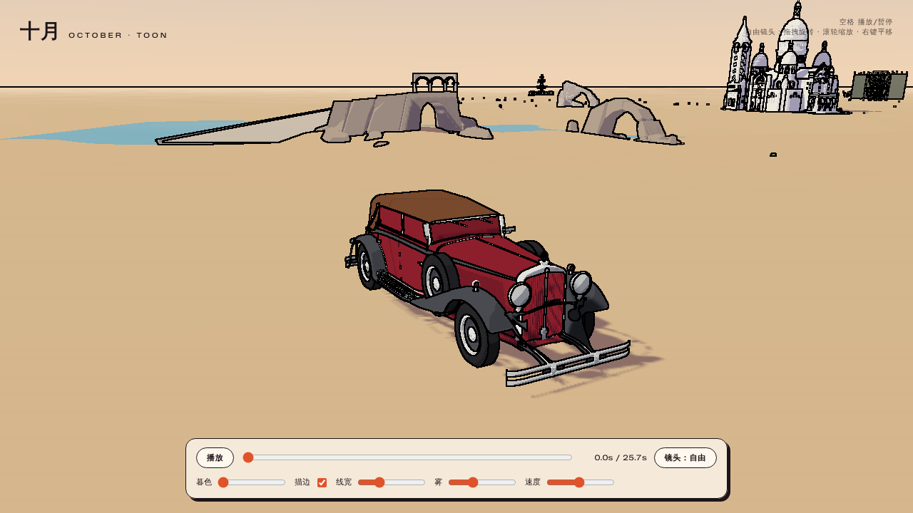
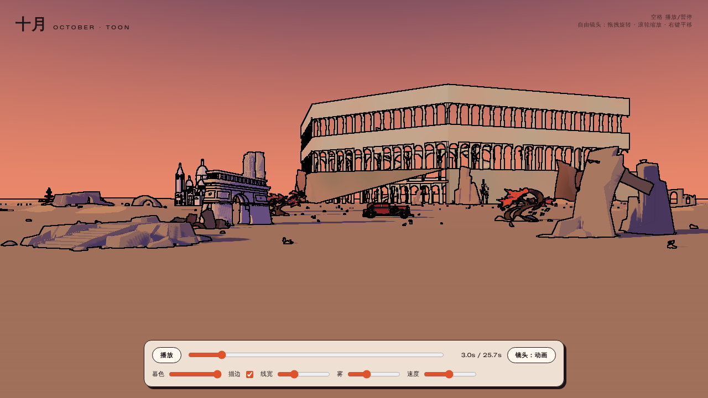

# 十月 · Toon Web

用 `motorbike/` 里逆向出的 Toon（赛璐璐）shader 渲染 `model/十月-test.glb`（C4D 导出、白模、25.7 s 镜头 + 老爷车动画）。


| 老爷车特写（自由镜头） | 暮色 | 宫殿内景 |
| --- | --- | --- |
|  |  |  |

## 运行

```bash
cd october-toon
npm install
npm run dev        # http://localhost:5173
npm run build      # 产物在 dist/（相对路径，可直接丢到任意静态服务器）
npm run preview    # 预览生产构建
```

操作：空格 播放/暂停、H 隐藏界面、F 全屏；底部面板有时间轴、`镜头：动画/自由` 切换（自由镜头 = OrbitControls）、暮色、描边开关、线宽、雾、速度。
调试入口：控制台 `__october`（`setTime(t)`、`setDusk(v)`、`setFog(v)`、`freeCam(pos, target)`、`animCam()`、`info()`）。

## 发布会现场（10527×1024 长条屏）

**最简单：双击 `start-stage.bat`**（Windows）。它会自动：安装依赖（仅第一次，需要联网）→ 打包 → 启动本地服务 → Chrome 全屏打开发布会模式。
需要提前装好 [Node.js](https://nodejs.org)（LTS 版）和 Chrome。

默认模式（`npm run dev` 打开的页面）也按 10527:1024 长屏比例居中显示，构图与现场一致（`?fit=window` 可恢复铺满窗口）。

发布会模式网址：`http://localhost:4173/?stage`
- 固定按 **10527×1024** 渲染（与模型里 C4D 相机的宽高比 10.2803 完全一致，镜头构图就是为这块屏做的），界面和鼠标隐藏，自动循环播放；
- 窗口不是这个尺寸时等比缩放，四周黑边；
- 如果显卡不支持这么宽（软件渲染 / 部分老核显上限 8192），会自动降分辨率再拉伸铺满，不会黑屏。

现场调参都写在网址里，**不用改代码**（多个参数用 `&` 连接）：

| 参数 | 作用 | 例子 |
| --- | --- | --- |
| `thickness` | 线宽：画面每 1080 像素高对应的像素数，默认 1.2。**与分辨率无关**：1080p、4K、长条屏上粗细比例一致 | `?stage&thickness=0.9` |
| `ink` | 线色：0 = 深梅棕墨色，1 = 取物体颜色压暗，默认 0.35 | `?stage&ink=0.2` |
| `fxaa=0` | 关闭抗锯齿（默认开） | `?stage&fxaa=0` |
| `outline=0` | 关闭描边 | `?stage&outline=0` |
| `scale` | 内部渲染分辨率倍数：<1 显卡卡顿时降低；1.5 / 2 = 超采样（更顺滑、更吃显卡） | `?stage&scale=0.75` |
| `dusk` | 暮色 0～1 | `?stage&dusk=0.6` |
| `fog` | 雾 0～3，默认 1 | `?stage&fog=1.5` |
| `speed` | 播放速度，默认 1 | `?stage&speed=0.8` |
| `dust` | 车后扬尘浓度，默认 1，0 = 关闭 | `?stage&dust=0.6` |
| `w` / `h` | 换别的固定分辨率 / 比例 | `?stage&w=5263&h=512` |
| `fit=window` | 默认模式不用长屏比例，铺满窗口 | `?fit=window` |

快捷键：空格 播放/暂停 · H 显示/隐藏界面 · F 全屏。

## 代码更新后怎么同步（给新手）

`october-toon` 文件夹是**自包含**的，不依赖仓库里其他文件夹，所以你只保留它是没问题的。

**推荐：用 GitHub Desktop（不用敲命令）**
1. 安装 [GitHub Desktop](https://desktop.github.com)，登录 GitHub。
2. File → Clone repository → 选 `547160097kishi-crypto/October` → 选一个本地位置 → Clone。
3. 顶部 **Current branch** 切到 `ccr-c9a8c133-916vgu`。
4. 以后有更新：点顶部 **Fetch origin**，再点 **Pull origin**，就同步好了。
5. 只用里面的 `october-toon` 文件夹，其他文件夹不用管（别删，删了 GitHub Desktop 会把它当成你的修改）。

**备选：继续用下载压缩包**
GitHub 网页 → 切到上面那个分支 → Code → Download ZIP → 解压后用新的 `october-toon` 整个替换旧的。
可以把旧文件夹里的 `node_modules` 挪过去省得重新安装（不挪也行，`start-stage.bat` 会自动装）。
注意：这样会覆盖你自己改过的文件，改过的话先备份。

**自己调参数**优先用上面的网址参数；要改颜色在 `src/palettes.ts`，改完浏览器会自动刷新（`npm run dev` 时）。

## motorbike 的 shader 实现（移植了什么）

| 模块 | motorbike 来源 | 做法 |
| --- | --- | --- |
| Toon 材质 | `toonMaterial.ts` → 原站 `MeshRampNoiseToonMaterial` | `MeshToonMaterial` + `onBeforeCompile` 替换 `<lights_toon_pars_fragment>`：直射光只取 3 阶梯度贴图（46/158/255，Nearest）的灰度，间接光清零；`<opaque_fragment>` 里用灰度在 `uDirectColor`/`uIndirectColor` 两色间混合 → 纯平色块 + 硬阴影。太阳光强 3（× 1/π ≈ 0.955 → 受光面 ≈ directColor） |
| Toon 阴影（十月改动） | — | 原站把 PCF 阴影（0~1 连续值）直接乘进梯度，阴影是一团软边灰阶。这里把阴影二值化（`fwidth` 抗锯齿的 1px 硬边），在阴影里的像素直接落到梯度最暗一阶 → 阴影与背光面同色、纯平；并设 `shadowSide = DoubleSide`，避免单层面片（车身、建筑）漏光 |
| 雾 | 原站 `FogBundle` | 强制 `USE_FOG + FOG_EXP2`，3D Perlin 噪声扰动雾深度、`fogTime` 缓慢流动，近/远两色 |
| 描边 | `outlinePass.ts` → 原站 `MoebiusEffect` | 原站：identity（灰度 + 深度项）→ 3×3 Sobel → ×100 截断成黑线。**十月改写为 5 个 pass**：① identity（R=物体 ID，G=线性深度）② 颜色 ③ 1 像素边缘：物体边只标在**前景一侧**；1/z 二阶差分的深度边（同一模型自己前后遮挡处也出线）；**法线折线**（同一物体相邻像素法线夹角 > 42°，160 单位内），作为细一档、淡一档的次线④ 墨线合成：以边缘像素为中心按距离场画线，**线宽 = 每 1080 像素高 N 像素**（分辨率无关、覆盖率自带抗锯齿）；线色 = 所属物体颜色压暗 + 深梅棕墨色；按距离变细变淡 ⑤ FXAA |
| 车后扬尘 | `dust.ts` → 原站 `initBikeParticles` | 同一张 `dust.png`（2×2 硬边团块图集）、同样的寿命 0.4s、尺寸曲线（1→6→11→5→0）与「速度 × rateFactor」发射率。烟团写进 identity（孪生体），所以有轮廓线、也挡住后面物体的描边。为老爷车改为：两个后轮发射、世界坐标模拟（车开走烟留在原地）、按动画真实车速驱动（停车不扬尘）、按世界尺寸换算像素（任何分辨率一样大）、帧间插值发射（低帧率不断成一簇簇）、Toon 两色（受光 + 背光月牙） |
| 日夜 | `setToonPaletteMix` | 每个色板 day / night 两套，按 mix 插值 —— 这里用作「暮色」滑杆 |
| 渲染器 | `RENDERER_CONFIG` | `antialias:false`、`pixelRatio ≤ 2`、PCF 阴影、`shadowMap.autoUpdate=false` 每帧手动更新 |

## 十月这边做的事

1. **模型压缩**（`scripts/optimize-model.mjs`，gltf-transform + meshoptimizer）：305 MB / 669 万三角 → **26.7 MB / 254 万三角**。dedup（1015 → 661 个网格，重复的石头/仙人掌合并）、weld、meshopt simplify（ratio 0.35、误差 0.15%）、去掉用不到的 UV、量化 + `EXT_meshopt_compression`。节点名、层级、动画全部保留。
   重新生成：`npm run model -- ../model/十月-test.glb public/models/october.glb`（先按 `model/README.md` 合并解压）。
2. **配色**（`src/palettes.ts`）：源模型 1013 个材质全是白色，颜色只能按节点路径分配。
   - 与 motorbike 场景同源的资源（`arch0xx`、`big_arch`、`palace*`、`stair_*`、`terasse`、`rock_dune_*_root`、`batiment`）直接用 motorbike 的 `toon-colors.json` 原值；
   - 十月独有的（凯旋门、圣心教堂、巴黎圣母院、枫树/枫叶、老爷车……）按秋日主题配色；老爷车按 C4D 子材质名（漆面 / 镍银 / 枪灰 / 胎面 / 皮革 / 尾灯）上色。
3. **地面延伸**：模型地面是一块不规则圆盘，镜头会拍到外面的虚空。运行时提取地面网格外边界环，向外做两圈过渡环（河道在边界的下切收回地平面），再 earcut 铺满 ±2500，远处交给雾融进天际线。
4. **相机**：C4D 相机 `yfov=8° / aspectRatio=10.28` 是为 10527×1024 长条屏设定的（水平 FOV 71.5°）。始终保持水平 FOV、按窗口比例换算竖直 FOV：长条屏上与 C4D 完全一致，普通 16:9 屏上下多看一些，竖屏上限 80°。

## 修掉的 motorbike 描边 bug（已在本项目修复，motorbike 本身未改）

- **所有物体共用一个 identity**：identity pass 里整场只有一个 override `ShaderMaterial`，three 对连续同材质绘制不会重新上传 uniform，`onBeforeRender` 写的 `uIdentity` 根本没生效 → 只有物体与天空交界处有线。修复：写完后置 `uniformsNeedUpdate = true`。
- **地面上的假横线**：identity 叠加了 `gl_FragCoord.z * 0.05`，8-bit RT 每跨一个 1/255 台阶，Sobel ×100 就画出一条横贯画面的黑线。identity RT 改为 HalfFloat。
- **扬尘画成实心方块**：`dust.png` 的 alpha 通道全是 255，移植版用 `max(tex.a, tex.r)` 当透明度恒为 1。改为只用 R 通道作遮罩。
- **地面 / 水面 identity 不确定**：它们不注册 identity 时会沿用上一个物体的值。改为写固定常量（`registerFlat`）。

## 喷泉水流（约 21s 起前景）

`src/fountain.ts`。先按高度切片分析模型轮廓（底池 / 中碗 / 上碗 / 顶碟的高度与半径），剔除模型里雕出的静态水滴三角面，再加：
- 三层水流：顶部冠状 6 股、上碗溢出 8 股、中碗溢出 10 股，**不用贴图高光，靠形状表现流动**（顶点着色器实时变形）：
  - 下宽上窄：出水口细而集中，往下变宽；越往下边缘越起伏弯折，中心线横向摆动；
  - 断开像水珠：后半段颈缩成上尖下圆的泪滴，中段随机断水，断口两侧是圆头；水珠随水流往下走、底部向两侧散开；
  - 团块轮廓：越往下，水柱与水珠的**外轮廓**逐步变成烟尘团块那种「圆鼓凸起 + 内凹尖角」（`jetLobe`，上段为 0、到水珠段最明显，图案随水流移动）；只改轮廓，明暗仍按光滑水柱计算，不出现每瓣各自的暗面；
- 四个水面：落水圈扩散的涟漪色带 + 色带边缘细墨线 + 白沫；
- 落点水花（烟尘同款硬边团块）。
全部用场景同一套 Toon 材质（色带、阴影、雾、暮色一致），全部参与描边（镂空的水流 / 水花用 identity 孪生体）。喷泉按真实时间流动，暂停时间轴也不停。

## 描边 / 上色技法选型

参考了主流三渲二做法（罪恶装备 Xrd 的背面外扩 + 贴图内线、原神的 ramp + 外扩描边 + 边缘高光、墨比斯风格的后处理边缘检测）。
本项目用后处理边缘检测：模型是 C4D 白模、面片不封闭、没有 UV，背面外扩会破面且要多画 254 万三角，贴图内线无从下手。
在此基础上解决了后处理描边的三个通病：线宽随分辨率变（→ 按画面高度比例）、纯黑线发重 / 远景噪点（→ 物体色墨线 + 距离衰减）、无抗锯齿（→ 覆盖率 + FXAA）。

## 已知事项

- 255 万三角 × 3 个 pass（阴影 / identity / 颜色）。10527×1024 是 1080p 的 5 倍像素，建议用独立显卡；卡顿就加 `&scale=0.75` 或 `0.5`。
- 截图是在无 GPU 的 headless Chromium（SwiftShader）里跑的，真实浏览器效果一致。
